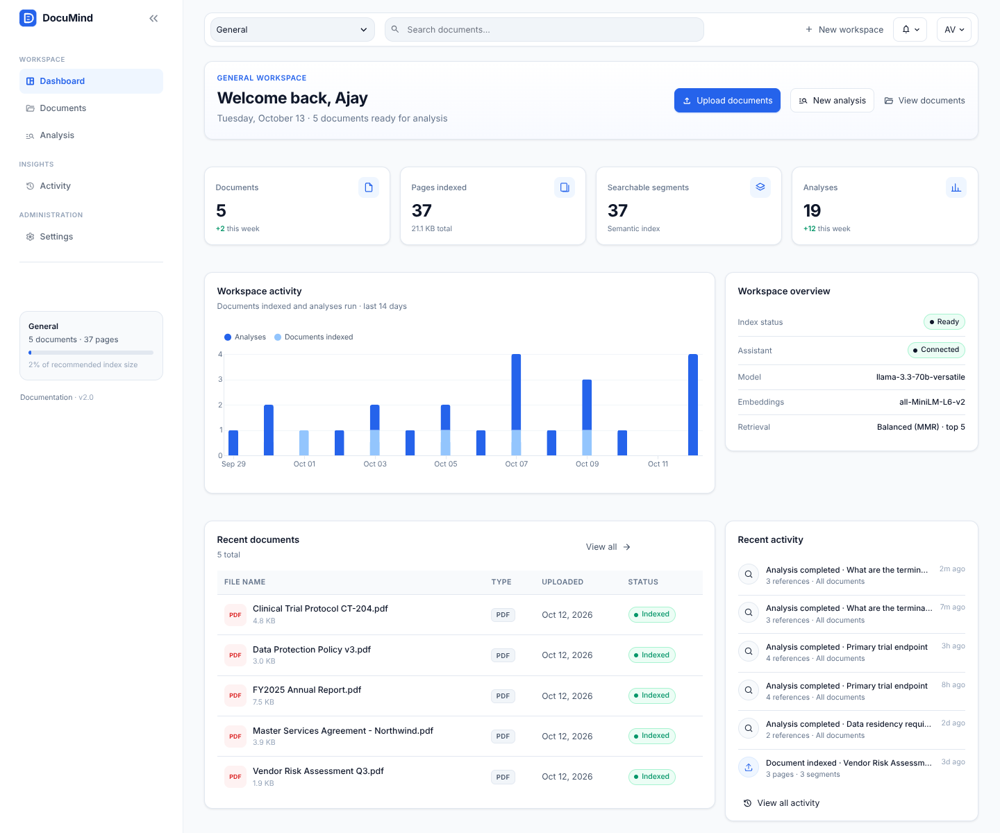
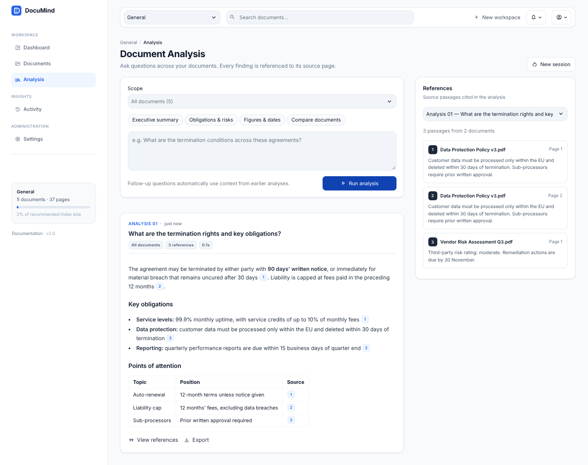
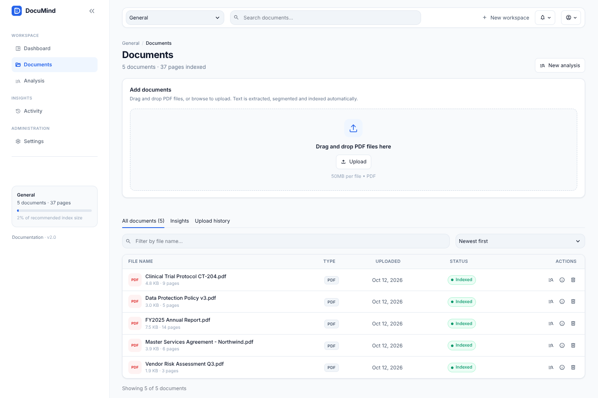
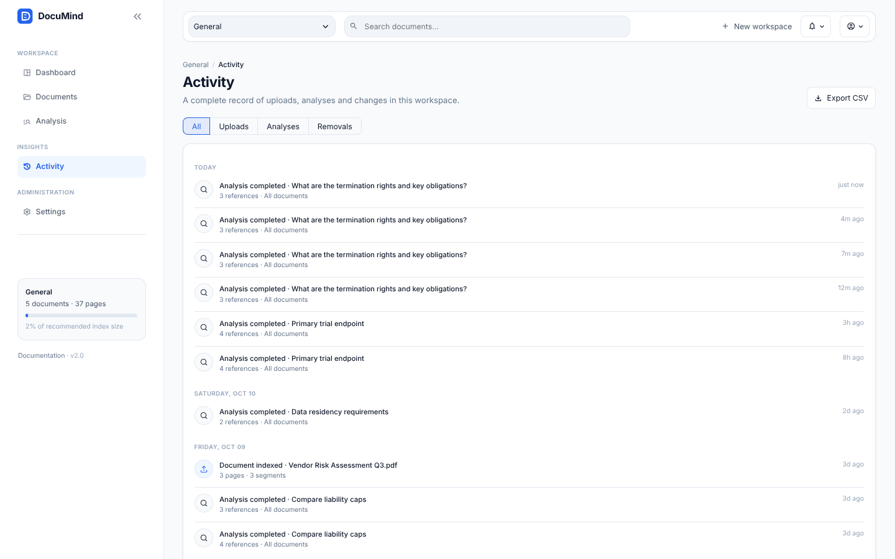
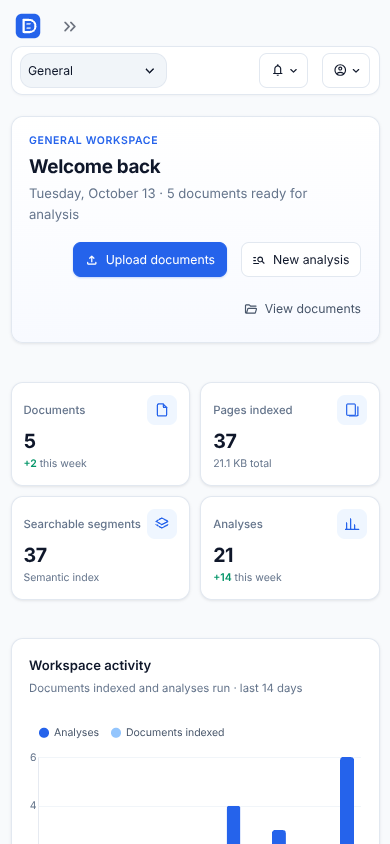
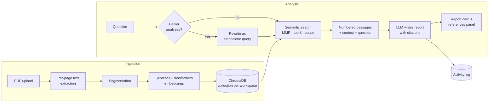

<div align="center">


### Document intelligence for teams that work with complex documents

Organise contracts, reports, policies and research into workspaces, then analyze them together.
Every finding is traced back to the exact source page.


**[Live demo](https://ajayvishal23-documind-rag-app-f2eb1g.streamlit.app/)** · [Architecture](docs/ARCHITECTURE.md) · [Deployment](docs/DEPLOYMENT.md)



</div>

---

## Overview

DocuMind is a retrieval-augmented document analysis platform. It is built for teams whose answers
live inside long documents: legal, finance, healthcare, education, consulting and enterprise operations.

- **Workspaces** keep each client, matter or project separate.
- **Document Analysis** answers questions across many PDFs at once, written as structured reports.
- **References** show the exact passage and page behind every claim, so findings can be verified.
- **Activity** keeps an exportable audit trail of uploads, analyses and changes.

## Product tour

| | |
|---|---|
|  |  |
| **Document Analysis.** Results appear as report cards with inline citation markers. A references panel lists the passages, pages and documents behind each one, and every report can be exported as Markdown. | **Document library.** Drag-and-drop upload, a sortable and filterable table with per-document actions (analyze, details, remove), upload history, and content insights. |
|  |  |
| **Activity log.** A timeline grouped by day and filterable by event type, with CSV export. | **Responsive.** The layout adapts to tablet and mobile; the sidebar collapses and tables drop secondary columns. |

<sub>Screenshots use sample documents.</sub>

## Capabilities

| Area | What it does |
|---|---|
| **Ingestion** | Multi-file PDF upload; per-page text extraction (`pypdf`) with cleanup; SHA-256 dedupe; encrypted, corrupt and scanned files are rejected with a clear reason |
| **Indexing** | Recursive, boundary-aware segmentation with overlap; Sentence-Transformers embeddings (`all-MiniLM-L6-v2`, runs locally on CPU); persistent ChromaDB with deterministic IDs |
| **Retrieval** | Semantic search with MMR (diverse) or strict similarity; scope analysis to selected documents; adjustable passages per analysis |
| **Analysis** | Report-style answers grounded only in retrieved passages; numbered citations mapped to file and page; streaming output; templates (executive summary, obligations and risks, figures and dates, comparison) |
| **Context** | Follow-up questions are rewritten into standalone queries using recent analyses, so "what about the second agreement?" retrieves correctly |
| **Workspaces** | One isolated vector collection and activity log per workspace; create and switch workspaces from the top bar |
| **Governance** | Activity log with CSV export; remove documents or clear a workspace behind confirmation dialogs; API keys only from environment or secrets |
| **Multiple models** | Pick any model your keys can use (Groq, OpenAI, or self-hosted Ollama) right in the Analysis composer; the list is fetched live from each provider. If a model is unavailable the next one is used automatically, and each report shows which model wrote it |

## Architecture



The UI is a thin presentation layer over a UI-agnostic `RAGPipeline`. Design notes and trade-offs are in
**[docs/ARCHITECTURE.md](docs/ARCHITECTURE.md)**.

## Quick start

```bash
git clone https://github.com/Ajayvishal23/documind-rag.git
cd documind-rag
python -m venv .venv && source .venv/bin/activate   # Windows: .venv\Scripts\activate
pip install -r requirements.txt

cp .env.example .env          # add GROQ_API_KEY (free key: console.groq.com/keys)
streamlit run app.py
```

Open http://localhost:8501, upload PDFs on the **Documents** page, then open **Analysis**.

To run with no external API, install [Ollama](https://ollama.com), run `ollama pull llama3.2`, and set
`LLM_PROVIDER=ollama`.

**Docker:** `cp .env.example .env && docker compose up --build`

## Project structure

```
documind-rag/
├── app.py                        # App shell: navigation, top bar, sidebar
├── assets/                       # Logo and icon
├── src/documind/
│   ├── config.py                 # Environment-driven settings
│   ├── schemas.py                # ChatAnswer, SourceCitation, IngestReport
│   ├── ingestion/                # PDF loading, cleaning, segmentation
│   ├── embeddings.py             # Sentence-Transformers via langchain-huggingface
│   ├── vectorstore.py            # ChromaDB wrapper + workspace listing
│   ├── llm.py                    # Provider factory: Groq | OpenAI | Ollama
│   ├── prompts.py                # Query rewriting + grounded report prompts
│   ├── memory.py                 # Sliding-window analysis context
│   ├── activity.py               # Per-workspace activity log (JSON lines)
│   ├── pipeline.py               # RAGPipeline: ingest → retrieve → answer → cite
│   └── ui/
│       ├── styles.py             # Design system (tokens, components, responsive rules)
│       ├── components.py         # Stat cards, tables, badges, feeds, empty states, skeletons
│       ├── actions.py            # Upload flow and modal dialogs
│       ├── state.py              # Session state, cached resources, navigation
│       └── views/                # dashboard · documents · analysis · activity · settings
├── tests/                        # 34 offline tests incl. headless UI tests for every page
├── docs/                         # Architecture, deployment, screenshots
├── .github/                      # CI, issue and PR templates
└── Dockerfile · docker-compose.yml · requirements*.txt · pyproject.toml · Makefile
```

## Design system

| Token | Value | Use |
|---|---|---|
| Primary | `#2563EB` | Actions, active navigation, citations |
| Secondary | `#1E293B` | Emphasis, reference markers, chart series |
| Background | `#F8FAFC` | App canvas |
| Surface | `#FFFFFF` | Cards, tables, panels |
| Border | `#E2E8F0` | Dividers, card outlines |
| Text | `#0F172A` | Primary text |

Inter typeface, 12px radius on cards, soft two-layer shadows, and a 14px base size. Theme values live in
`.streamlit/config.toml`; component styles live in `src/documind/ui/styles.py`.

## Configuration

Settings come from environment variables (`.env`, shell, or Streamlit secrets). See [`.env.example`](.env.example).

| Variable | Default | Purpose |
|---|---|---|
| `LLM_PROVIDER` / `LLM_MODEL` | `groq` / provider default | Assistant model |
| `GROQ_API_KEY` / `OPENAI_API_KEY` | — | Provider credentials |
| `EMBEDDING_MODEL` | `sentence-transformers/all-MiniLM-L6-v2` | Any Sentence-Transformers model |
| `CHUNK_SIZE` / `CHUNK_OVERLAP` | `1000` / `150` | Segment size in characters |
| `TOP_K` / `SEARCH_TYPE` | `5` / `mmr` | Default retrieval behaviour |
| `CHROMA_PERSIST_DIR` | `./data/chroma` | Index storage |
| `CHROMA_COLLECTION` | `general` | Default workspace |

## Testing

```bash
pip install -r requirements-dev.txt
make test      # pytest + coverage
make lint      # ruff
```

Tests run offline. A deterministic hashing embedder and a scripted chat model replace the real ones. They
cover extraction, segmentation, dedupe, persistence, scoping, retrieval, citation mapping, query rewriting,
context memory, the activity log, HTML escaping of model output, and headless rendering of every page with
and without documents.

## Design decisions

- **Report cards instead of a chat transcript.** Analyses are independent, exportable artifacts with
  their own references, which suits review workflows better than a scrolling conversation.
- **Query rewriting.** Embedding a bare follow-up retrieves noise; rewriting it into a standalone query
  fixes multi-turn retrieval.
- **Citations that can be verified.** Passages are numbered in the prompt and the model must cite them.
  Markers are parsed back to file and page, and out-of-range markers are discarded.
- **MMR by default.** Business documents repeat boilerplate; MMR keeps the evidence diverse.
- **Safe rendering.** Model output is HTML-escaped before display, so injected markup in a document can't
  execute in the UI.
- **UI-agnostic core.** `RAGPipeline` has no Streamlit imports and accepts per-call model and retrieval
  overrides, so one cached pipeline serves many sessions with different preferences.

## Roadmap

- [ ] Hybrid search (BM25 + vectors) with reciprocal-rank fusion
- [ ] Cross-encoder re-ranking
- [ ] OCR for scanned PDFs
- [ ] Evaluation suite (faithfulness, answer relevancy, context precision)
- [ ] Authentication and per-user workspaces
- [ ] REST API (FastAPI) alongside the web app

## License

MIT, see [LICENSE](LICENSE).

---

<div align="center">
Built by <b>Ajay Vishal M V</b> · <a href="https://github.com/Ajayvishal23">GitHub</a>
</div>
