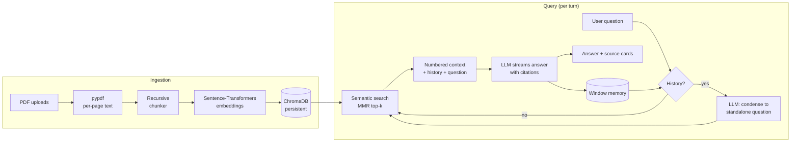

<div align="center">

# 📚 DocuMind

**Chat with multiple PDFs — grounded answers with page-level citations.**

A production-style Retrieval-Augmented Generation (RAG) chatbot built with
Streamlit, LangChain, ChromaDB and Sentence-Transformers.


[Live demo](#) · [Architecture](docs/ARCHITECTURE.md) · [Deployment](docs/DEPLOYMENT.md)

<!-- Replace with a real screenshot / GIF: docs/assets/demo.gif -->
<!--  -->

</div>

---

## ✨ Features

| | |
|---|---|
| 📄 **Multi-PDF upload** | Index many PDFs at once; duplicates detected by SHA-256 content hash |
| 🧹 **Robust text extraction** | Per-page extraction with `pypdf`, whitespace + hyphenation cleanup, encrypted / scanned PDF handling |
| ✂️ **Smart chunking** | Recursive splitting on paragraph → sentence → word boundaries with overlap; page metadata kept on every chunk |
| 🧠 **Local embeddings** | `all-MiniLM-L6-v2` via Sentence-Transformers — free, private, runs on CPU |
| 🗄️ **Persistent vector store** | ChromaDB (cosine / HNSW) persisted to disk; idempotent re-indexing via deterministic chunk IDs |
| 🔎 **Semantic search** | MMR (diverse) or similarity search, optional score threshold, filter to selected documents |
| 💬 **Conversation memory** | Sliding-window memory + *question condensing* so follow-ups like "what about its limitations?" retrieve correctly |
| 📌 **Source citations** | LLM cites `[n]` markers that map back to file + page, with expandable source excerpts |
| ⚡ **Streaming answers** | Token-by-token responses in a ChatGPT-style interface |
| 🔌 **Pluggable LLMs** | Groq (free tier), OpenAI, or fully local Ollama — switch in the sidebar |
| ✅ **Tested & containerised** | 21 offline tests (incl. headless UI tests), GitHub Actions CI, Docker |

## 🏗️ Architecture



Full design notes, trade-offs and data flow: **[docs/ARCHITECTURE.md](docs/ARCHITECTURE.md)**.

## 🚀 Quick start

```bash
git clone https://github.com/Ajayvishal23/documind-rag.git
cd documind-rag
python -m venv .venv && source .venv/bin/activate   # Windows: .venv\Scripts\activate
pip install -r requirements.txt

cp .env.example .env          # then add your GROQ_API_KEY (free: console.groq.com/keys)
streamlit run app.py
```

Open http://localhost:8501, upload PDFs in the sidebar, click **Index documents**, and start chatting.

> **No API key?** Install [Ollama](https://ollama.com), run `ollama pull llama3.2`, and set
> `LLM_PROVIDER=ollama` — everything then runs 100% locally.

### Docker

```bash
cp .env.example .env   # add your key
docker compose up --build
```

## 📁 Project structure

```
documind-rag/
├── app.py                      # Streamlit entry point (thin UI layer)
├── src/documind/
│   ├── config.py               # env-driven Settings dataclass
│   ├── schemas.py              # ChatAnswer, SourceCitation, IngestReport
│   ├── ingestion/
│   │   ├── loader.py           # PDF → per-page Documents (+ hashing, cleaning)
│   │   └── chunker.py          # recursive splitting, deterministic chunk ids
│   ├── embeddings.py           # Sentence-Transformers via langchain-huggingface
│   ├── vectorstore.py          # ChromaDB wrapper: add / dedupe / search / delete
│   ├── llm.py                  # provider factory: Groq | OpenAI | Ollama
│   ├── prompts.py              # condense + grounded-answer prompts
│   ├── memory.py               # sliding-window conversation memory
│   ├── pipeline.py             # RAGPipeline: ingest → retrieve → answer + cite
│   └── ui/                     # Streamlit components + CSS
├── tests/                      # pytest (offline: fake embedder + fake LLM)
├── docs/                       # ARCHITECTURE.md, DEPLOYMENT.md
├── .github/                    # CI workflow, issue & PR templates
├── Dockerfile · docker-compose.yml
├── requirements.txt · requirements-dev.txt · pyproject.toml · Makefile
└── .env.example
```

## ⚙️ Configuration

All settings come from environment variables (`.env`, shell, or Streamlit secrets).

| Variable | Default | Purpose |
|---|---|---|
| `LLM_PROVIDER` | `groq` | `groq` · `openai` · `ollama` |
| `LLM_MODEL` | provider default | e.g. `llama-3.3-70b-versatile`, `gpt-4o-mini`, `llama3.2` |
| `EMBEDDING_MODEL` | `sentence-transformers/all-MiniLM-L6-v2` | Any Sentence-Transformers model (e.g. `BAAI/bge-small-en-v1.5`) |
| `CHUNK_SIZE` / `CHUNK_OVERLAP` | `1000` / `150` | Characters per chunk / overlap |
| `TOP_K` | `5` | Chunks sent to the LLM |
| `SEARCH_TYPE` | `mmr` | `mmr` (diverse) or `similarity` |
| `MEMORY_WINDOW` | `6` | Conversation turns remembered |
| `CHROMA_PERSIST_DIR` | `./data/chroma` | Where vectors are stored |

See [`.env.example`](.env.example) for the full list.

## 🧪 Testing

```bash
pip install -r requirements-dev.txt
make test      # pytest + coverage
make lint      # ruff
```

Tests run **fully offline** — a deterministic hashing embedder and a scripted fake chat model
replace the real ones — covering extraction, chunking, dedupe, persistence, file filters,
retrieval, citation mapping, question condensing, memory, and headless Streamlit UI flows.

## 🧭 Design decisions

- **Question condensing over raw history retrieval.** Embedding "what about its limitations?"
  retrieves noise; rewriting it with chat history into a standalone question fixes multi-turn recall.
- **Numbered-context citations.** Each retrieved chunk is labelled `[n]`; the prompt requires
  `[n]` citations, which are parsed back to file + page. Uncited chunks are hidden, so users see
  only the evidence actually used.
- **MMR by default.** Multi-PDF corpora often contain near-duplicate passages; MMR trades a little
  relevance for diversity so the context window isn't wasted on repeats.
- **Content-hash dedupe + deterministic IDs.** Re-uploading the same file (even renamed) is a no-op.
- **UI-agnostic core.** `RAGPipeline` has no Streamlit imports, so it can be reused behind FastAPI
  or a CLI, and is unit-testable.

## 🗺️ Roadmap

- [ ] Hybrid search (BM25 + vectors) with reciprocal-rank fusion
- [ ] Cross-encoder re-ranking (`bge-reranker`)
- [ ] OCR fallback for scanned PDFs (Tesseract)
- [ ] RAGAS evaluation suite (faithfulness, answer relevancy, context precision)
- [ ] Per-user collections and auth
- [ ] FastAPI backend + REST API

## 📜 License

MIT — see [LICENSE](LICENSE).

---

<div align="center">
Built by <b>Ajay Vishal M V</b> · <a href="https://www.linkedin.com/in/your-profile">LinkedIn</a> · <a href="https://github.com/Ajayvishal23">GitHub</a>
</div>
