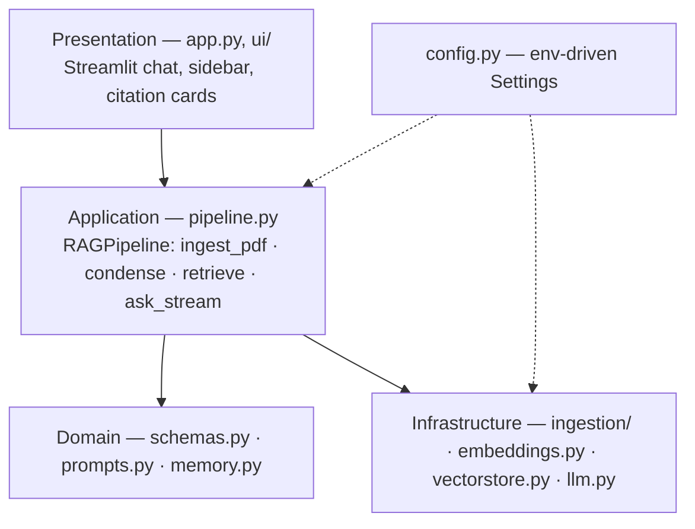
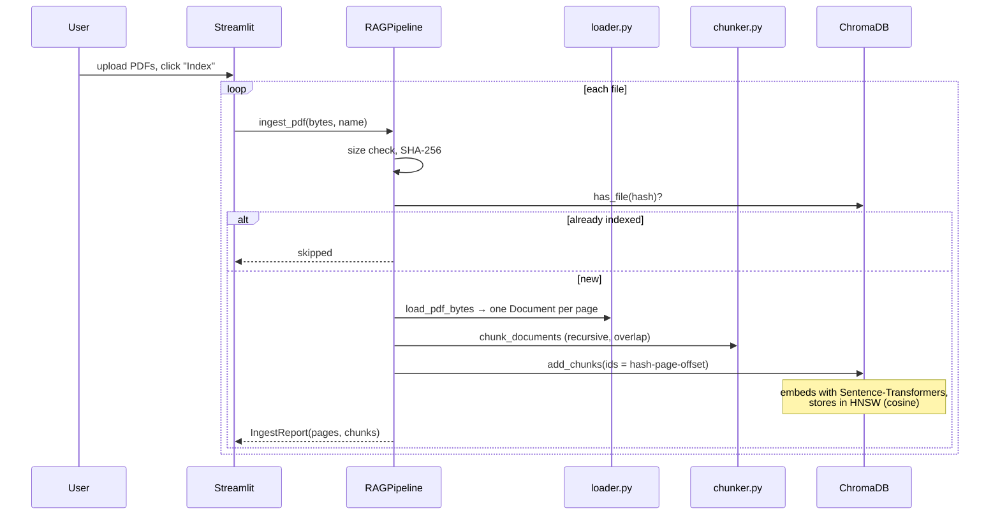
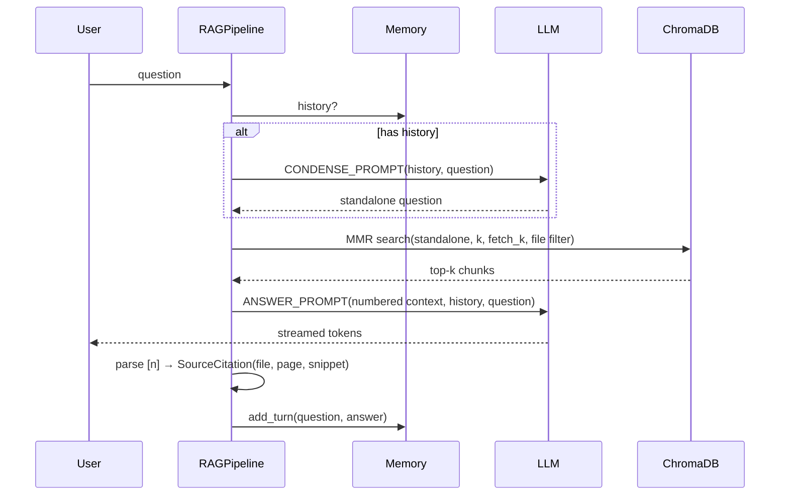

# Architecture

DocuMind is a two-phase RAG system: an **ingestion pipeline** that turns PDFs into
searchable vectors, and a **conversational query pipeline** that answers questions
grounded in those vectors.

## 1. Layered design

| Layer | Responsibility | Depends on Streamlit? |
|---|---|---|
| Presentation | Rendering, session state, uploads, streaming display | Yes |
| Application | Orchestrates the RAG flow; returns typed results | No |
| Domain | Data objects, prompts, memory | No |
| Infrastructure | PDF parsing, embeddings, ChromaDB, LLM providers | No |

Keeping Streamlit out of everything below the presentation layer means the pipeline is
unit-testable with fakes and can be put behind FastAPI or a CLI without changes.

## 2. Ingestion pipeline

**Key choices**

- **Per-page documents** — page numbers survive chunking, enabling `file.pdf — p.7` citations.
- **Cleaning** — joins words hyphenated across line breaks, collapses whitespace, strips NULs.
- **Chunking** — `RecursiveCharacterTextSplitter` with separators
  `\n\n → \n → . → ? → ! → ; → , → space`. Default 1000 chars / 150 overlap (~200 tokens),
  which suits MiniLM's 256-token window while keeping enough context per chunk.
- **Deterministic chunk IDs** (`<hash16>-p<page>-<start_index>`) make ingestion idempotent.
- **Batching** — writes in batches of 256 to stay under Chroma's max batch size.
- **Failure handling** — corrupt, encrypted or text-less (scanned) PDFs are skipped with a
  reason; one bad page doesn't abort the whole file.

## 3. Query pipeline

**Why condense?** Follow-ups are usually not self-contained. Embedding "and its limitations?"
matches random chunks; rewriting it to "What are the limitations of solar power?" retrieves
the right page. The condense step is skipped on the first turn (no extra latency/cost) and
falls back to the raw question if it errors.

**Why MMR?** Maximal Marginal Relevance (`λ = 0.6`) re-ranks `fetch_k = 20` candidates to
pick `k` that are relevant *and* mutually diverse — important when several PDFs repeat the
same boilerplate. Switch to `SEARCH_TYPE=similarity` (+ `SCORE_THRESHOLD`) for strict relevance.

**Grounding & citations.** The system prompt restricts the model to the numbered context,
requires `[n]` citations, and defines an explicit "couldn't find it" response. After
streaming, citations are parsed with a regex, validated against the number of retrieved
chunks (hallucinated `[9]` is ignored), and mapped back to file/page/snippet. If the model
cites nothing, all retrieved chunks are shown so evidence is never hidden.

**Memory.** A sliding window of the last `MEMORY_WINDOW` turns is stored per Streamlit
session and passed to both prompts. This bounds prompt size; a summary-buffer memory is a
natural extension for very long chats.

## 4. Data model (Chroma metadata per chunk)

| Field | Example | Used for |
|---|---|---|
| `source` | `annual_report.pdf` | Citation label, file list |
| `page` | `7` | Citation label |
| `total_pages` | `42` | Sidebar stats |
| `file_hash` | `9f86d0…` | Dedupe, delete, search filter |
| `start_index` | `1840` | Chunk id, ordering |
| `chunk_id` | `9f86d08188…-p7-1840` | Primary key |

## 5. Trade-offs & limitations

| Decision | Upside | Cost / limitation |
|---|---|---|
| MiniLM-L6 embeddings | Free, fast on CPU, private | Lower recall than `bge-large`/OpenAI embeddings; English-centric |
| pypdf | Pure Python, no system deps | No OCR, weak on complex tables/multi-column layouts |
| Single shared collection | Simple | Not multi-tenant: all sessions see the same documents |
| Window memory | Predictable cost | Forgets older turns |
| Regex citations | Transparent, cheap | Relies on model following the format (strong models do) |

## 6. Extension points

- **Re-ranking:** insert a cross-encoder between `retrieve()` and prompt building.
- **Hybrid search:** combine BM25 (`rank_bm25`) with vector hits via reciprocal-rank fusion.
- **Evaluation:** RAGAS / a golden Q&A set run in CI to catch retrieval regressions.
- **API:** wrap `RAGPipeline` in FastAPI; the Streamlit app becomes one client.
- **Multi-tenant:** one Chroma collection per user/session id.
